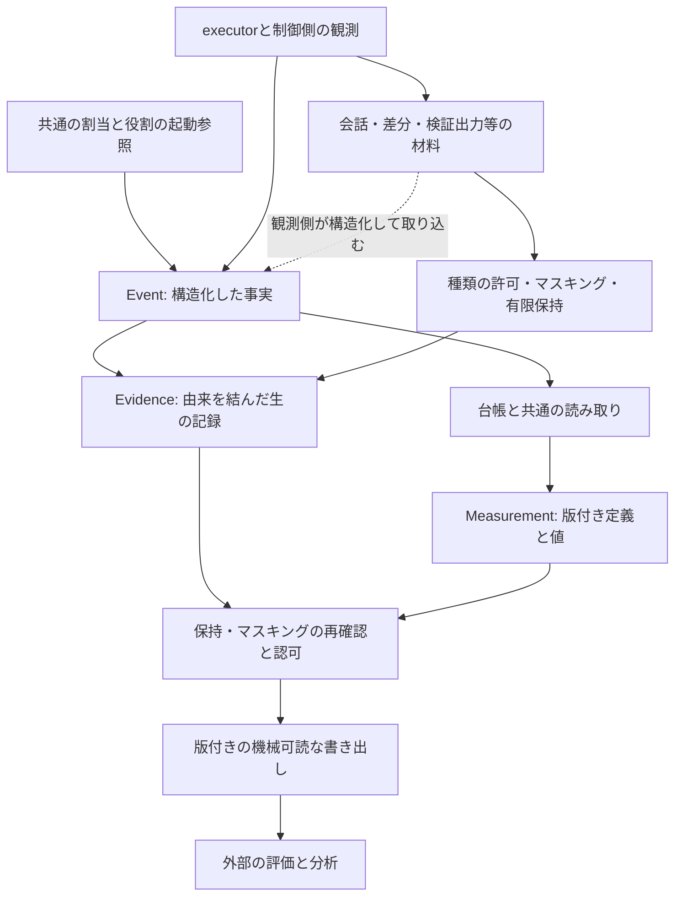

# Agent比較実験のEvidenceとMeasurement

割当と実行の記録を、再分析できる材料と算術の値へ結ぶ実装前の地図。
本文の保持と公開の境界を示すものであり、今のbinaryに一般の収集・書き出しが実装済みとは述べない。
具体の形・設定・値と実装先への移管は[実装前の追加契約](../plans/agent-experiments-contract.md#8-evidenceの収集と由来)を読む。

## 記録の流れ

EventからEvidenceへ進む矢印は新しい事実の正本を複製する意味ではなく、由来を結んで提供する意味である。
Evidenceから値を作る経路は観測側の取り込みを経由し、統計が材料を直接読む近道は作らない。
同じ構造化した入力は既存の台帳と共通の読み取りを通り、書き出し専用の統計系を持たない。
測定値から制御の割当や実行結果を復元する逆向きの流れはない。

## Event・Evidence・Measurementの境界

### Eventは起きたこと

Eventは制御と観測が記録した構造化した事実である。
状態の変更と同時に確定する約束は既存のまま保つ。
起動の意図と実際が違うこと、起動できなかったことも記録の対象となる。
agentが述べた結果と、制御側が照合できた結果を同じ信頼の事実にしない。

### Evidenceは由来を持つ生の記録

EvidenceはEventや本文を、割当・起動・成果物の由来で辿れるようにした生の記録である。
生であるとは、指摘や出力を測定値へ置き換えないことで、secretを含む原文を保存することではない。
本文は消えてよい材料であり、その所在の文字列だけでは当時の内容を証明しない。
保存した内容の同一性と、マスキングや削除による利用可能性を分ける。
本文が消えても、記録の保持範囲で何が失われたかを説明できるようにする。

割当の正本は共通の最初の記録にあり、Evidenceはそれを参照する。
実験の版・群と役割の意図を、実際のproviderから推測して補わない。
計画側の出どころと実行側の割当は別の関係であり、下流の群を計画の群で置き換えない。
runの無い起動にも由来を結び、全役をrun中心の記録へ押し込まない。

### Measurementは定義に従う値

Measurementは名前と版のある測定定義から求めた値である。
定義は単位・範囲・方法を説明し、値は対象・入力の到達点・欠損理由・推計の印を持つ。
算術の集計と、どの指標を重視するかの評価方針を分ける。
判定の回数を数えることは、その判定が正しいとの認定ではない。

入力の不足と本文の非開示は同じではない。
本文が非開示でも、認可された構造化した観測から得た値は提供できる場合がある。
反対に本文が残っていても、必要な構造化した入力の無い測定は欠損のままである。
export時に本文を読んで埋めると、同じ窓の統計が読み手によって変わる。

## 保持とマスキングとアクセス

大きな本文は管理された保存先で有限に保持し、構造化した記録と寿命を分ける。
保存先の種類を変えても、保持・マスキング・認可の境界を迂回しない。
終了したrunの記録の写しは取得元であり、写しを作ること自体は安全な公開の許可ではない。
実行中の制御と復旧に要る元の記録を、実験用の量の制限で削除しない。

秘密と個人情報は取り込みの境界で最小化し、処理できない本文を既定で公開しない。
秘密の単純なhashは秘匿の証明にならず、マスキング後の内容の識別と使い分ける。
マスキングのために内容が変わった場合、元と同じ入力を再現したとは説明しない。
全ての秘密を検出できるとの保証はせず、許可した種類と規則の版の範囲を説明する。

本文の読み取りと大量の書き出しは、通常の状態の読み取りとは別に認可する。
保存先の参照は対象に結び、agentの任意の参照から別の対象の資料を取得させない。
権限による欠損は存在を漏らさない範囲で説明し、秘密の対象名を理由の文へ写さない。
hostで同一UIDに対して助言的な境界であることは、この保存契約でも変わらない。

監査は権限行使と来歴の独立した追記の記録で、Evidence本文の保管庫ではない。
本文の削除は監査の削除に波及せず、監査へのsecretの複製も許さない。
保存と転送の費用はproviderの推論費用と分け、単価が不明なら不明とする。
保持期間を延ばすことと、再分析できる範囲を広げることは同じ費用判断を要する。

## 書き出しと比較条件

書き出しは内部の保存形式や人向けの表示から独立し、スキーマの版と入力の到達点を持つ。
測定定義の版と出力形式の版は別の変化であり、片方をもう片方で代用しない。
未対応の破壊的な版を推測して読まずに拒み、見慣れた欄だけで完全な比較にしない。
遅れて届く観測で結果が変わりうるため、同じ期間の出力でも入力の到達点を確認する。

通常運用の観測と制御したBenchmarkは、同じ形式で提供しても混ぜない。
Benchmarkは同じ入力と初期commitからの比較であり、群名が同じだけでは条件の一致を示さない。
環境と道具と外部のmodelの変化、並列実行の干渉は、入力を揃えても残りうる。
条件の逸脱と不明を残し、制御したという表示だけで因果の証明にしない。

同一成果物への独立reviewと、生成・review・修正を含むEnd-to-Endの比較を分ける。
将来のReplayは固定した成果物と別のreviewerの起動を結ぶ拡張点であり、この設計では実行器を作らない。
現在の資料から過去のsnapshotを推測して埋めない。
evalの固定入力・隔離・本番と共通の起動の部品は共有できるが、合否・採用方針・期待の秘匿は既存の境界に従う。
元の判定や期待を別のreviewerへ見せれば、同じ成果物でも独立reviewの比較ではなくなる。

## 不変条件と分析の落とし穴

生の記録と測定の値は分離し、再計算で生の記録を書き換えない。
測定には版と単位と範囲と方法を持たせ、欠損理由と推計の印を落とさない。
既存の論理ストアと共通の読み取りを保ち、統計は状態や消えてよい材料を読まない。
書き出しは版付きで順位を持たず、評価指標の重みと総合スコアを付けない。
Benchmarkと通常運用を暗黙に合算しない。
保持とマスキングを通らないEvidenceを出さず、出力時にも認可と利用可能性を確認する。

retryや修正で起動が増えても独立した割当が増えたとは限らない。
plannerが下流の仕事の数を変える場合、起動やtaskの件数をそのままplannerの標本数にしない。
fallbackや失敗や欠測を成功群から落とすと、割当時の母集団が変わる。
既存の個別のkpiの層の意味を保ちつつ、由来と被覆を外の分析へ渡す。

tokenの実行とsessionの区間を重複して加算しない。
費用の現在の換算を当時の請求額として出さず、出所と価格の版を確認する。
マスキング後の記録から除去した情報は復元できず、保持期限後の再抽出も約束しない。
構造化した入力が残る範囲の再計算と、本文からの再抽出の可否を別に説明する。

## 判断と詳細への入口

[境界のADR](../adr/2026-11-17-t5121-1-evidence-and-versioned-measurements.md)はEvidenceとMeasurement、既存の台帳、由来の結合を決める。
[保存のADR](../adr/2026-11-17-t5121-2-bounded-evidence-storage-and-access.md)は有限保持・秘密・認可・監査と費用の境界を決める。
[書き出しのADR](../adr/2026-11-17-t5121-3-versioned-experiment-export-and-modes.md)は互換と比較条件とReplayの拡張点を決める。
[実装前の追加契約](../plans/agent-experiments-contract.md#8-evidenceの収集と由来)は収集の不足・最小の出力・保持と権限の候補を持ち、実装と同時に定義のそばへ正本を移す。
