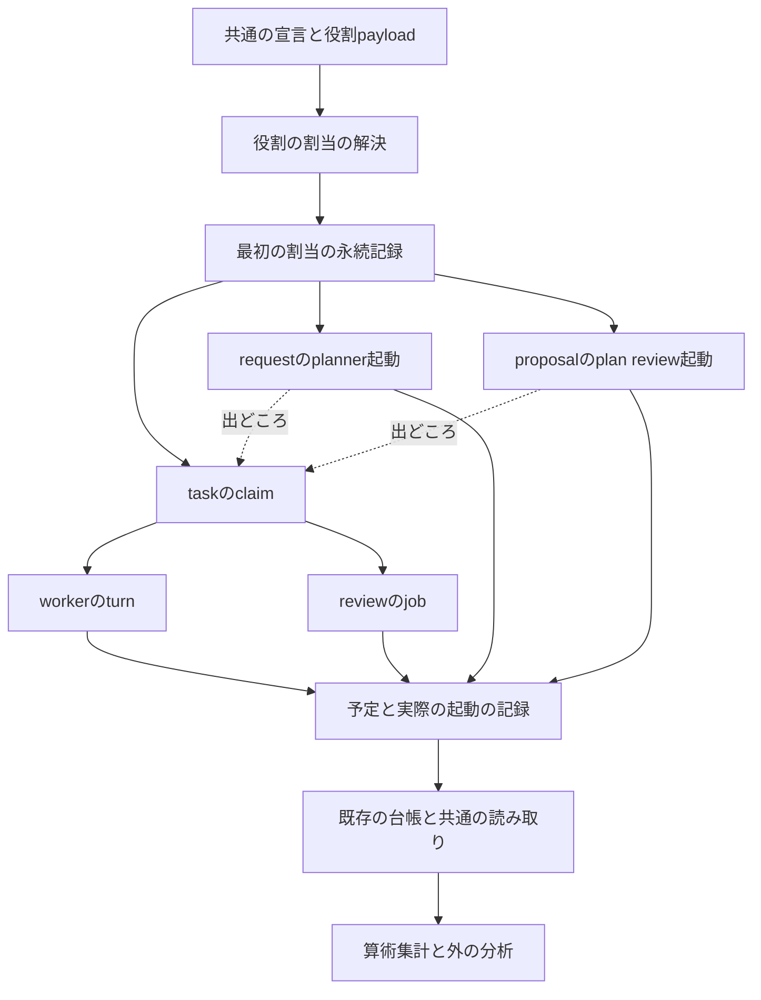

# Agent比較実験

役割に使うagentを比較するための、実装前の地図。
既存の起動経路に役割の割当を接続する境界を示し、今のbinaryで一般の割当が動くとは述べない。
具体の構文・検査・式・保存項目は[実装前の追加契約](../plans/agent-experiments-contract.md)を読む。

## 目的と責務

DAGQは実験条件の設定・割当・実行、事実・計測値・成果物の収集・永続化・提供と算術集計を担う。
指標の重視、評価のスコアと重み付け、順位、modelの選定は外の分析者と道具が担う。
固定の総合評価のスコアをruntimeに置かない。
この境界の理由は[責務境界のADR](../adr/2026-11-17-t5120-1-agent-experiment-responsibility-boundary.md)にある。

実験群ごとのkpiは、この境界の中で算術集計として提供する。
件数や率の表示と、どの群を採用するかの評価を分ける。
既存の固定入力の[eval](agent-eval.md)は固有の合否と採用方針を持ち、その評価を全実験へ強制しない。
通常運用の観測は入力の揃ったBenchmarkではなく、将来のReplayとも区別する。

## 模型と共通契約との境界

役割は仕事、割当先は名前付きの起動条件であり、権限の主体やreviewの検査定義とは別の概念である。
実験と群は共通の実験契約のものを使い、役割専用の第二の実験管理を作らない。
割当は対象と実験の版・群・役割の割当先を結び、実行はその割当を参照する。
一つの割当から複数のrunやjobが起動しても、割当を起動回数だけ複製しない。

共通契約は宣言、決定的な群の割当と版、最初の記録からの復元、収集の終了と決着を持つ。
役割の割当はその上に、agentの選択、役割の組、計画側の対象、起動の意図と実態の対応を足す。
共通契約の未実装部分の前提と接続先は[追加契約](../plans/agent-experiments-contract.md#位置づけと正本の移し方)を読む。
役割の選択を値の上書きと一体化すると、worker限定の実験条件がreviewへ漏れるため、別の解決口にする。

Independentは役割ごとに群の割当先を選び、Combinationは役割の組を群として一度に選ぶ。
部分指定の群は、省略した役割を通常の設定に戻す約束であり、別の群から補う指定ではない。
競合は群を選ぶ前に役割の予約で検査し、記述順や優先度で隠さない。
Combinationの指定、予約の重ならないIndependent、通常の設定という優先関係は、競合検査を通ったものだけに適用する。

## 主な部品と接続する流れ

共通の宣言を読む係と役割payloadを読む係は、名前と共通の版で結び付く。
割当を解決するdomainの判断と、確保・記録するstoreの境界を分け、provider adapterに抽選を持たせない。
役割の解決は起動前に終え、executorは解決された起動の組を既存の権限の範囲で実行する。

### claimとworker

claimへの接続の入口は`infrastructure::task_store::claim_task_filtered`。
対象の確保と最初の割当の保存を同時に行い、workerの起動は保存した割当を参照する。
開いたclaim属性は共通の群を運ぶ口であり、割当の実効条件を最新の設定から復元する口ではない。
workerの段上げとturnの境界は[Worker model](supervisor-lifecycle/worker-model.md)の既存の責務を保つ。
runnerのpullも含め、割当を通せない入口を比較の対象に黙って含めない。

### runtimeのplanner

plannerの起動への接続の入口は`application::planner`。
requestに結び付く計画の割当を、plannerを最初に開く前に確保して記録する。
plannerのprocessの生存期間ではなくrequestを固定境界とするため、差し戻しで開き直しても同じ割当を参照できる。
requestを解決できない仕事を、便宜的に別の対象へ混ぜない。
計画の起動経路と段上げの入口は[Actor model](supervisor-lifecycle/actor-model.md)を読む。

### plan review

plan reviewへの接続の入口は`PlanningState::start_plan_review`。
単独の比較はproposalに固定し、plannerとの組の比較は共通のrequestの割当を参照する。
同じproposalへの再reviewは同じ意図で起動し、起動の試みは別に残す。
plannerの出力が変わってproposalが増えることと、新しい独立標本が増えることを同一視しない。
下流taskへ渡す計画側の割当は出どころであり、taskの実験群の代わりにはしない。

### reviewのjob

reviewの起動の組を解決する入口は`RoleModels::review_plan`。
reviewはそのrunが参照する割当からreview自身の起動先を解決し、jobごとの予定と実際を残す。
workerの環境やprompt等の値の上書きをreviewの入力条件として持ち越さない。
検査の定義、信頼する規則、programのreviewの順序は[Review](supervisor-lifecycle/review.md)の責務のままである。
同じ役割の中に複数のjobがあることと、群を複数回抽選することを分ける。

### 永続化と読み取り

割当の確保は制御の書き込みであり、計測の台帳から逆算しない。
起動の実態は既存の実行参照に結び付け、executorから観測した事実として収集する。
群の運搬は開いた属性を再利用し、軸を足すたびに台帳やkpiに専用の列を増やさない。
正本・ビュー・材料の境界は[計測](measurement.md)を、属性の記録の入口は[属性の記録](attribute-records.md)を読む。
Evidence本文の保存と書き出しの詳細は追加契約の担当であり、この地図では新しい保存先を定義しない。

## 不変条件と落とし穴

実験を宣言しないrepositoryは、既存の役割の選択・段上げ・fallback・個々の試しと同じ振る舞いを保つ。
新しい役割割当の宣言を読むことと、旧試しを新しい宣言へ移すことは別の実装境界である。
既存の試しの具体の制約を一般模型の制約へ広げず、一般模型の自由度で旧試しの約束を取り消さない。

群と意図した割当先は固定し、起動できるかという判断は起動の時点の事実として扱う。
resume・revise・retry・supervisorの再起動は再抽選の機会ではない。
停止・削除・重みや候補の編集は既存の割当の意味を変えず、共通契約に従って新規割当へだけ反映する。
段上げや人の介入による起動条件の変化は、意図の書き換えではなく理由付きの実態として残す。

fallbackは既存の許可と待ちに従い、群を切り替え先の群へ移さない。
意図、介入後の予定、起動へ渡した条件、実際に観測した条件は異なりうる。
provider専用のmodelを別のproviderへ渡さず、観測できない実モデルは不明とする。
設定どおりのjob別の混在をfallbackと誤認しない。
比較では切り替えた層や欠測を落とすと母集団が変わるため、群だけから実行条件を推定しない。

重みは割当の確率であり、少数実行の件数比の保証でも評価指標の重みでもない。
抽選を再現できることはLLMの出力、modelの実体、prompt、CLI、外部状態の完全再現とは異なる。
依存taskの成果物の共有やhostの負荷による干渉は、taskの固定だけでは除けない。
plannerの比較では下流taskの数や難易度自体が変わるため、出どころの参照を保って外の分析へ渡す。

計画側と実行側を跨ぐ一括の組は、共通の固定境界を追加で決めるまで受け付けない。
割当先を増やしても、未対応の役割とproviderの組が起動可能になるわけではない。
integrateには役割の割当もworkerの値の上書きも渡さず、着地の検証とGitの所有境界を保つ。

## 判断と詳細への入口

責務は[ADR-t5120-1](../adr/2026-11-17-t5120-1-agent-experiment-responsibility-boundary.md)、役割割当の追加契約は[ADR-t5120-2](../adr/2026-11-17-t5120-2-role-assignment-extension-contract.md)が決める。
具体の構文・重みの式・復元の記録・旧試しとの接続は[実装前の追加契約](../plans/agent-experiments-contract.md)が持ち、実装と同時にコードの定義のそばへ正本を移す。
