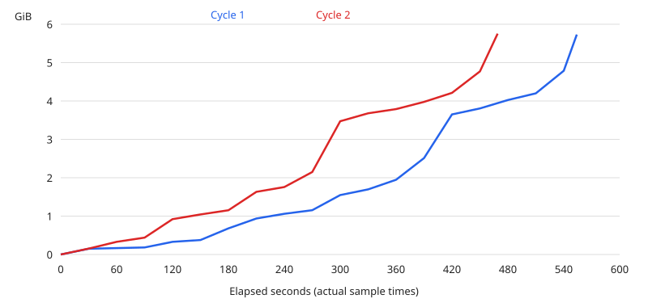

# 走っているrunの大きさの測定

## 環境

対象は `190e3fb6474e74b2d874e053a37aab7d898cf072` の自分のworktreeだけ。
runtimeと設定、ADR-0047 決定44は変えていない。

| 項目 | 値 |
|---|---|
| OS / host | MacBook-Air、Darwin arm64 27.2.0、macOS 27.2（26B123）、論理CPU 8。機種・メモリのsysctlはこのworkerでは拒否された |
| ファイルシステム | `/dev/disk3s5`、APFS、`/System/Volumes/Data`。worktreeとTMPDIRは同じst_dev（16777232）、statvfsのblockは4096 bytes |
| rustc | 1.99.1（58cf8f9c35b355199727627d07ae34a4e2846d67、2026-10-13）、LLVM 23.1.1、aarch64-apple-darwin |
| cargo / Python | cargo 1.99.1（5f94df478、2026-08-27）、Python 3.9.6 |
| build設定 | `CARGO_BUILD_JOBS=4`、`RUST_TEST_THREADS=6`、`NEXTEST_TEST_THREADS=6`。既定のworktreeのtargetを使用 |
| wrapper | このrunの `dagq-rustc-wrapper`。`SCCACHE_IGNORE_SERVER_IO_ERROR=1`、`SCCACHE_ERROR_LOG=/dev/null/dagq-refuses-the-sccache-server`。sccache 0.19.0。共有serverの起動・設定変更はしていない |
| providerと経路 | このrunの非対話worker。1周目はClaudeの引き継ぎ成果、2周目以降はCodexのhost上のsandbox経由。Codex自身でもbuildと測定の経路を確認した |

同時のload1はbuildの観測中4.72〜18.62、終了後の走査測定中6.23〜11.20で、元のCSVの各測定行に記録した。
他のrunのworktreeは走査せず、共有キャッシュ自体も走査していない。
hostに負荷を作るprocessを足さず、ツールをインストールしていない。
`diskutil info`はDiskManagement frameworkを利用できず、ファイルシステムは `mount` と `statvfs` で確かめた。

## 打ったものと数え方

測定scriptは [measure.py](disk-run-size-measure-spike/measure.py)、元の数値は [growth.csv](disk-run-size-measure-spike/growth.csv)・[counts.csv](disk-run-size-measure-spike/counts.csv)・[cycles.csv](disk-run-size-measure-spike/cycles.csv)・[clone.csv](disk-run-size-measure-spike/clone.csv) に保存した。
`tree` は `src/infrastructure/run_files.rs` の `tree_size` と同じ集計規則で、rootを含めたlstat相当の走査、directoryも加算、symlinkをたどらず、(st_dev, st_ino)の集合で重複を除いてst_blocks × 512を足す。
Python版は実装のdescriptorによる競合対策までは写していない。
安定した測定対象の集計を突き合わせるためのscriptであり、runtimeにそのまま移す実装ではない。
file数はdirectoryを除くentry数（hard linkの各名前を含む）。
`du` は `du -sk` の値を1024倍したbytes。
`naive_comparison_only` は重複を除かないst_blocksの単純加算で、比較用だけに使う。

```sh
python3 docs/plans/disk-run-size-measure-spike/measure.py cycle 1
python3 docs/plans/disk-run-size-measure-spike/measure.py cycle 2 --rm-estimate 5
```

各周で空のtargetから、次を順に実行し、その間30秒ごとと終了時に測った。
各コマンドは `scripts/cargo-brief.sh --log "$TMPDIR/…"` 経由で実行した。

```sh
cargo clippy --locked --all-targets -- -D warnings
cargo test --locked --lib --no-run
```

削除は自分のtargetだけに行う。
削除前に自分の操作をせずW秒のstatvfsを読み、noiseは窓の始点と終点の空きの差の絶対値とした。
補助として窓内5秒ごとの最大−最小もCSVのnoise_rangeに残した。
Δfree_rmは削除直前を基準に直後・30秒後の空き増加の大きい方。
noise ≤ tree × 5%かつ周の前後の `tmutil listlocalsnapshots /` と `/System/Volumes/Data` に新しいsnapshotが無ければ比較可能とする。
1周目のWは削除見積り30秒＋30秒、2周目は実績0.6秒を上回る見積り5秒＋30秒。

## 増え方

全値はbytes。30秒ごとのsampleの間の短い山は捉えていない。



| 周 | 経過秒 | target tree bytes | file数 |
|---|---|---|---|
| 1 | 0 | 0 | 0 |
| 1 | 30 | 160993280 | 1186 |
| 1 | 60 | 178888704 | 1573 |
| 1 | 90 | 196890624 | 1594 |
| 1 | 120 | 354304000 | 1595 |
| 1 | 150 | 404635648 | 1595 |
| 1 | 180 | 730849280 | 1669 |
| 1 | 210 | 1006768128 | 1670 |
| 1 | 240 | 1138569216 | 1676 |
| 1 | 270 | 1239232512 | 1676 |
| 1 | 300 | 1662558208 | 2426 |
| 1 | 330 | 1821941760 | 2426 |
| 1 | 360 | 2091163648 | 2427 |
| 1 | 390 | 2697379840 | 2596 |
| 1 | 420 | 3919134720 | 2950 |
| 1 | 450 | 4086906880 | 2950 |
| 1 | 480 | 4321787904 | 2950 |
| 1 | 510 | 4508794880 | 2954 |
| 1 | 540 | 5140774912 | 3129 |
| 1 | 554 | 6153830400 | 3469 |
| 2 | 0 | 0 | 0 |
| 2 | 30 | 165183488 | 1366 |
| 2 | 60 | 354304000 | 1595 |
| 2 | 90 | 471744512 | 1595 |
| 2 | 120 | 988815360 | 1670 |
| 2 | 150 | 1120616448 | 1676 |
| 2 | 180 | 1238056960 | 1676 |
| 2 | 210 | 1753067520 | 2426 |
| 2 | 240 | 1887285248 | 2426 |
| 2 | 270 | 2307842048 | 2431 |
| 2 | 300 | 3728666624 | 2949 |
| 2 | 330 | 3951108096 | 2950 |
| 2 | 360 | 4068548608 | 2950 |
| 2 | 390 | 4269875200 | 2950 |
| 2 | 420 | 4522356736 | 2952 |
| 2 | 450 | 5122760704 | 3098 |
| 2 | 469 | 6178664448 | 3469 |

観測した途中の最大は1周目5,140,774,912 bytes、2周目5,122,760,704 bytes。
終了時はそれぞれ6,153,830,400 / 6,178,664,448 bytesで、どちらも途中の最大を上回った。
観測上は「途中の最大が終了時を超える」ことは無い。
ただし30秒の間のpeakや、別の編集・buildの反復は調べていない。
今の大きさが小さい間は `max(0, 想定 − 今の大きさ)` は大きくなり、保守的に残りを予約する。
反対に、peakの後で縮んだのに古い大きいsampleを使うと残りを過小評価する。
単調増加を仮定して過去の最大を今の値として保持することはできない。

## 数え方ごとの測定

値はbytes、実時間は秒（小数3桁に丸め、0.000は0.0005秒未満）。単純加算は比較用。worktreeにはtargetも含む。

| 周 | 対象 | 数え方 | 回 | 値 bytes | 実時間 s | load1 |
|---|---|---|---|---|---|---|
| 1 | worktree | tree（既存方式・重複除去） | 1 | 6217338880 | 0.066 | 11.2 |
| 1 | worktree | du -sk | 1 | 6217342976 | 0.057 | 11.2 |
| 1 | worktree | 単純加算（比較用） | 1 | 7422894080 | 0.058 | 11.2 |
| 1 | target | tree（既存方式・重複除去） | 1 | 6153830400 | 0.034 | 11.2 |
| 1 | target | du -sk | 1 | 6153830400 | 0.035 | 11.2 |
| 1 | target | 単純加算（比較用） | 1 | 7359381504 | 0.033 | 11.2 |
| 1 | tmpdir | tree（既存方式・重複除去） | 1 | 16384 | 0.0 | 11.2 |
| 1 | tmpdir | du -sk | 1 | 16384 | 0.007 | 11.2 |
| 1 | tmpdir | 単純加算（比較用） | 1 | 16384 | 0.0 | 11.2 |
| 1 | worktree | tree（既存方式・重複除去） | 2 | 6217342976 | 0.063 | 11.2 |
| 1 | worktree | du -sk | 2 | 6217342976 | 0.055 | 11.2 |
| 1 | worktree | 単純加算（比較用） | 2 | 7422894080 | 0.057 | 11.2 |
| 1 | target | tree（既存方式・重複除去） | 2 | 6153830400 | 0.035 | 11.2 |
| 1 | target | du -sk | 2 | 6153830400 | 0.034 | 11.2 |
| 1 | target | 単純加算（比較用） | 2 | 7359381504 | 0.033 | 10.78 |
| 1 | tmpdir | tree（既存方式・重複除去） | 2 | 16384 | 0.0 | 10.78 |
| 1 | tmpdir | du -sk | 2 | 16384 | 0.006 | 10.78 |
| 1 | tmpdir | 単純加算（比較用） | 2 | 16384 | 0.0 | 10.78 |
| 1 | worktree | tree（既存方式・重複除去） | 3 | 6217342976 | 0.06 | 10.78 |
| 1 | worktree | du -sk | 3 | 6217342976 | 0.054 | 10.78 |
| 1 | worktree | 単純加算（比較用） | 3 | 7422894080 | 0.058 | 10.78 |
| 1 | target | tree（既存方式・重複除去） | 3 | 6153830400 | 0.036 | 10.78 |
| 1 | target | du -sk | 3 | 6153830400 | 0.034 | 10.78 |
| 1 | target | 単純加算（比較用） | 3 | 7359381504 | 0.035 | 10.78 |
| 1 | tmpdir | tree（既存方式・重複除去） | 3 | 16384 | 0.0 | 10.78 |
| 1 | tmpdir | du -sk | 3 | 16384 | 0.007 | 10.78 |
| 1 | tmpdir | 単純加算（比較用） | 3 | 16384 | 0.0 | 10.78 |
| 2 | worktree | tree（既存方式・重複除去） | 1 | 6242201600 | 0.075 | 6.23 |
| 2 | worktree | du -sk | 1 | 6242201600 | 0.066 | 6.23 |
| 2 | worktree | 単純加算（比較用） | 1 | 7448338432 | 0.07 | 6.23 |
| 2 | target | tree（既存方式・重複除去） | 1 | 6178664448 | 0.045 | 6.23 |
| 2 | target | du -sk | 1 | 6178664448 | 0.041 | 6.23 |
| 2 | target | 単純加算（比較用） | 1 | 7384801280 | 0.042 | 6.23 |
| 2 | tmpdir | tree（既存方式・重複除去） | 1 | 73728 | 0.0 | 6.23 |
| 2 | tmpdir | du -sk | 1 | 73728 | 0.004 | 6.23 |
| 2 | tmpdir | 単純加算（比較用） | 1 | 73728 | 0.0 | 6.23 |
| 2 | worktree | tree（既存方式・重複除去） | 2 | 6242201600 | 0.076 | 6.23 |
| 2 | worktree | du -sk | 2 | 6242201600 | 0.067 | 6.23 |
| 2 | worktree | 単純加算（比較用） | 2 | 7448338432 | 0.068 | 6.23 |
| 2 | target | tree（既存方式・重複除去） | 2 | 6178664448 | 0.041 | 6.23 |
| 2 | target | du -sk | 2 | 6178664448 | 0.039 | 6.23 |
| 2 | target | 単純加算（比較用） | 2 | 7384801280 | 0.04 | 6.23 |
| 2 | tmpdir | tree（既存方式・重複除去） | 2 | 73728 | 0.0 | 6.23 |
| 2 | tmpdir | du -sk | 2 | 73728 | 0.004 | 6.23 |
| 2 | tmpdir | 単純加算（比較用） | 2 | 73728 | 0.0 | 6.23 |
| 2 | worktree | tree（既存方式・重複除去） | 3 | 6242201600 | 0.074 | 6.23 |
| 2 | worktree | du -sk | 3 | 6242201600 | 0.066 | 6.23 |
| 2 | worktree | 単純加算（比較用） | 3 | 7448338432 | 0.076 | 6.23 |
| 2 | target | tree（既存方式・重複除去） | 3 | 6178664448 | 0.047 | 6.23 |
| 2 | target | du -sk | 3 | 6178664448 | 0.045 | 6.23 |
| 2 | target | 単純加算（比較用） | 3 | 7384801280 | 0.048 | 6.23 |
| 2 | tmpdir | tree（既存方式・重複除去） | 3 | 73728 | 0.0 | 6.23 |
| 2 | tmpdir | du -sk | 3 | 73728 | 0.006 | 6.23 |
| 2 | tmpdir | 単純加算（比較用） | 3 | 73728 | 0.0 | 6.23 |

同じ周・同じ回のtreeのworktree全体＋TMPDIRの和を1 runの時間とし、その最大は1周目約0.07秒、2周目約0.08秒（観測load1 6.23〜11.20）。
worktreeの最初の1回は測定CSV自身の更新でduと4096 bytes違うが、判定対象のtargetは全回一致した。
TMPDIRは測定時16,384 / 73,728 bytesと小さく、大きなscratchpadを持つrunの走査時間は調べていない。

## 周ごとの空きの差

| 周 | tree bytes | du bytes | 絶対差 / du | W s | noise bytes | Δfree_rm bytes | E_target | 比較可能 |
|---|---|---|---|---|---|---|---|---|
| 1 | 6153830400 | 6153830400 | 0.0 | 60 | 84570112 | 6292324352 | -0.0225 | True |
| 2 | 6178664448 | 6178664448 | 0.0 | 35 | 1433600000 | 6144000000 | 0.0056 | False |

E_target = (tree − Δfree_rm) / tree。
1周目のnoiseは1.37%で5%以内、snapshot増加0なので比較可能。
2周目はnoiseが23.20%で5%を超えるため判定から除く（snapshot増加0）。
snapshotの1周目はscriptが前後の差をCSVに残し、2周目は加えて前後の空の一覧も [snapshots.csv](disk-run-size-measure-spike/snapshots.csv) に保存した。
削除は0.6 / 0.7秒で、どちらもWの見積りを超えていない。
1周目の削除直後は6,132,465,664、30秒後は6,292,324,352 bytes増えた。
負のE_target（−2.25%）は物理的な負の使用量という意味ではなく、他の書き込み・削除や空きの反映の揺れを含む観測値である。
2周目の値はそれぞれ6,144,000,000 / 5,939,200,000 bytes。
Codex経由のstatvfsには空きの値が粗い刻みで変わる観測もあり、小さい変化を厳密に0と断定しない。

## クローン

`python3 docs/plans/disk-run-size-measure-spike/measure.py clone --repeat 1` を実行した。
自分のTMPDIRのclone-exp内へ `dd if=/dev/urandom bs=1m count=2048` で2 GiBのsourceを作り、30秒待った後、2周目と同じW=35秒のnoise窓を取った。
その後 `cp -c source.bin clone.bin` の直前・直後のTMPDIR全体を測った。
Δfreeはこの実験だけは「空きの減少」を正として読む。
実験後にsourceとcloneを消した。

| 回 | Δtree bytes | Δdu bytes | Δfree bytes | noise bytes | E_clone | 比較可能 |
|---|---|---|---|---|---|---|
| 1 | 2147098624 | 2147098624 | 0 | 81920000 | 1.0 | True |

cpのexitは0、cloneのprivate sizeは0、clone refcountは2。
noiseはΔtreeの3.82%で5%以内、snapshot増加0なので比較可能。
E_clone = (Δtree − Δfree) / Δtree = 100%。
この窓では空きの減少を検出しなかったという値で、metadataの割当てまで厳密に0 bytesという主張ではない。
別inodeのcloneをtreeもduも独立したbytesとして数えるので、両者の一致はクローンの過大評価を防がない。

## 共有キャッシュと道具の確かめ

targetの各名前についてst_nlinkと、そのtarget内に現れた同じ(dev, ino)の個数を突き合わせた。
外部へのhard linkはst_nlinkが内部の名前の数より大きい場合として検出し、symlinkは行き先を解決して内外を調べるだけで走査はしない。
これは自分のtargetから共有実体への接続があるかの検査で、他のrunや共有キャッシュを読む検査ではない。
APFSのcloneはinodeが別なので、この検査だけでは分からない。
補助的にmacOSのgetattrlistでprivate size・clone ID・clone refcountも読んだ（[inspect.csv](disk-run-size-measure-spike/inspect.csv)）。

hard linkの割合は「2回以上現れたinodeに属する全entryのbytes / 単純加算」とした。
重複分そのものの割合 `(単純加算 − tree) / 単純加算` も併記し、inodeを1回だけ数えたbytesを分子にする読み方と区別する。

道具について確認した公式source・文書:

- [Cargoのlink_or_copy](https://github.com/rust-lang/cargo/blob/5f94df478/crates/cargo-util/src/paths.rs#L606-L689) は、macOSではfileをstd::fs::copyし、特定のエラーではhard linkへfallbackする。source自身もAPFSのcopy-on-writeを使うと説明している。
- [std::fs::copy 1.99.1](https://doc.rust-lang.org/1.99.1/std/fs/fn.copy.html) は、macOSではfclonefileatとfcopyfileに対応する。したがって、別inodeになっても独占したblocksとは限らない。
- [rustcのincremental](https://github.com/rust-lang/rust/blob/58cf8f9c35b355199727627d07ae34a4e2846d67/compiler/rustc_incremental/src/persist/fs.rs) は前sessionからhard-link/copyし、[link_or_copy](https://github.com/rust-lang/rust/blob/58cf8f9c35b355199727627d07ae34a4e2846d67/compiler/rustc_fs_util/src/lib.rs#L62-L85) はhard linkを先に試してからstd::fs::copyへfallbackする。

| 対象 | 内部hard link inode数 | 外部hard link inode数 | symlink数 | hard link割合 | 重複分割合 | clone refcount>1のinode数 |
|---|---|---|---|---|---|---|
| target 周1 | 514 | 0 | 0 | 32.76% | 16.38% | 141 |
| target 周2 | 514 | 0 | 0 | 32.67% | 16.33% | 141 |
| TMPDIR（clone前） | 0 | 0 | 0 | 0% | 0% | 0 |

clone refcount>1のinodeでst_blocksからprivate sizeを引いた合計は両周42,909,696 bytes。
同じclone IDがtarget内に2つ以上あるgroupは22で、最大のfileを1つ残す計算の重複分は19,705,856 bytesだった。
これは物理extentを全部追跡した値ではなく補助値であり、E_targetの代わりには使わない。
外部hard linkとsymlinkは検出せず、共有cacheへのlinkがtreeを膨らませる証拠は今回無かった。
cloneを使う経路とclone自体は実在するが、このbuildでは比較可能な周のE_targetの10%超過としては現れなかった。

共有cacheのhit率はこのrunだけに分離して測っていない。
sccacheのwrapperがあることから、全artifactが共有cache由来・またはすべて独立した実体であるとは結論しない。
claim-holdの「queueのdirのビルドのキャッシュ」のupdate/target・landing recheckのbuild出力も自分のtargetの外にあり、その実体自体は測っていない。
今回見える外向きlinkの有無と、削除で実際に増える空きの値を根拠とする。

## 問いごとの判定と根拠

**総合: holds（指定の閾値と、このbuild・hostで観測した範囲）。**

| 問い | 判定 | 根拠 |
|---|---|---|
| (a) 1 runの測定時間が60秒以内か | holds | 全周・全回のworktree＋TMPDIRの最大は約0.08秒。測定時load1 6.23〜11.20 |
| (b) targetでduとの差が10%以内か | holds | 両周とも全回0%。分母はdu |
| (c) 比較可能な周のE_target最大が10%以内か | holds | 比較可能な1周目の−2.25%が最大。分母はtree。2周目はnoiseで除外 |
| clone実験が比較可能か | holds | noise 3.82%、snapshot増加なし、cp -c成功・clone refcount 2。E_cloneは100% |
| 共有cache・cloneが実際のbuildを10%超過大評価したか | この観測では認めない | 外部linkなし。内部cloneはあるが比較可能なE_targetは10%以下 |

比較可能な周が1つ以上あり、clone実験も比較可能で、(a)・(b)・(c)をすべて満たすためholdsとした。
E_cloneを(c)の代わりにはしていない。
これは1本の冷えたtargetのbuildを調べた結果で、cloneを多用する別PJや、大きなTMPDIR、測定値の10分間の鮮度を保証する判定ではない。

## 後続の計画への推奨

既存方式をloopの外のthreadで読む実装を計画できる。
形は [待つrunの測定](../design/supervisor-lifecycle/host-metrics.md#待つrunのビルド成果物) の一覧取得と走査を分け、走査が重ならない形を参考にする。
ただし、今回の小さいTMPDIRと約6 GBのtargetで速かったことを、あらゆるPJで60秒以内という保証にはしない。

E_cloneが10%を大きく超えたので、cloneを作る道具を持つPJではtreeが物理的な独占量を大きく上回り得る。
macOSのCargoにもその経路があり、今回のE_targetが低かっただけで一般に安全とは言えない。
汎用のclaimで共有の有無を立証できない場合、treeを今の大きさから差し引かず、今の大きさを0として想定そのままを数える保守的な扱いを推奨する。
空きの実測はclaim時に読み、最低ラインと1本を前へ進める規則の計画を別に進める。
claim時からの空きの差は、他のrunやcacheの書き込みが混ざるため、この測定ではrunごとの帰属を立証していない。

測定が失敗・中断したときや、build出力を消したときは、過去の大きい値を残りの予約から引く根拠に使わない。
測定成功の時刻と対象の同一性を確認できても、sample後にrun自身が出力を縮める可能性は残る。
10分の既定間隔をそのままclaimの安全性の根拠とせず、信頼できない値は0へ倒す扱いを計画に含める。
このSpikeでは実装・ADRの変更や後続taskの登録は行わない。

Linux、ext4、XFS、Btrfs、ZFS、ネットワークファイルシステム、別のAPFS hostでは調べていない。
このhost・このbuild・観測したloadでの結果を、それらの環境に外挿しない。
測定不能・期限切れ・比較不能・共有の所在が不明なら、今の大きさを0として扱い、走っているrunには想定そのままを予約するのが安全な側になる。

## 使った時間と回数

run作成の15:13 JSTから実験終了15:37まで約24分。
文書化・自己レビュー・検査・receiptを含めても60分以内で終了する。
空のtargetからの周回は2回（上限3回）、clone実験は1回。
1周目clippy / test --no-runは283 / 271秒、2周目は193 / 276秒で、いずれもexit 0。
1周目は削除の測定を含めてClaudeからの引き継ぎで完了したCSVとログを採用し、2周目とcloneはCodex自身の経路で完了を確認した。
3周目は、比較可能な周とclone実験が得られたため行わなかった。
